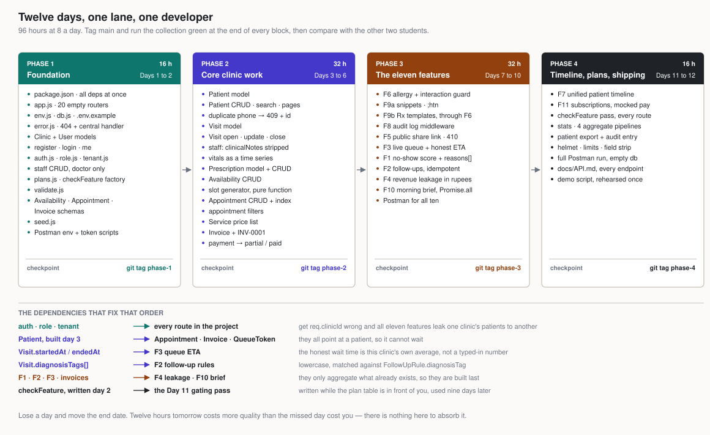
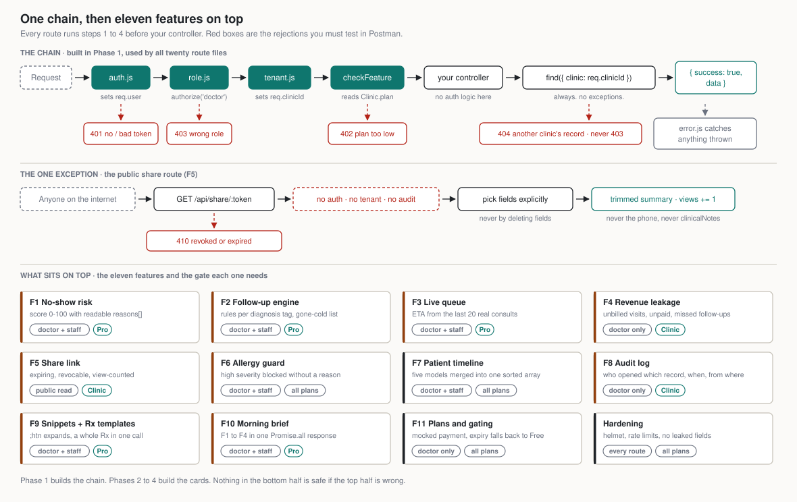

# Build Guide — the 12 days

`ASSIGNMENT.md` tells you **what** to build and what each day owes. `GETTING_STARTED.md` tells you **how to work**. This file is **the order inside each day, and why that order** — it is the file you open every morning and keep open.

You are building all of it: identity, multi-tenancy, the clinical record, scheduling, money, the eleven features, the plan gate, the hardening. Alone, in your own repo, in **12 days at 8 hours a day**.



*Twelve days, one lane. The arrows are the dependencies that fix the order: nothing works before the tenancy chain, appointments need `Patient`, the queue needs closed visits, the brief and the leakage report need everything.*

---

## The one idea that holds the whole project together

Every request in this API — all twenty route files, all eleven features — runs the same four-step chain before it reaches your code:



1. **`auth.js`** verifies the JWT and sets `req.user = { id, role, clinic }`. Bad or missing token → **401**.
2. **`role.js`** (`authorize('doctor')`) rejects the wrong role → **403**.
3. **`tenant.js`** copies `req.user.clinic` into `req.clinicId`.
4. **`checkFeature('queue')`** loads the clinic's plan and rejects a feature the plan doesn't include → **402**.

Then your controller runs, and it queries **always with `{ clinic: req.clinicId }`**. A record from another clinic returns **404, not 403** — a 403 tells the attacker the record exists.

Finally `error.js` turns anything thrown anywhere into `{ success: false, message }`.

That is the whole architecture. Get this chain right on Days 1 and 2 and the next 80 hours are just filling in controllers. Get `req.clinicId` wrong and **every feature in the project leaks one clinic's patients to another** — which is a lawsuit, not a bug.

So two of your twelve days go to code that implements no feature at all. That is the correct trade.

## How to run a day

Eight hours is two or three tasks, not one. The rhythm that works:

| | |
|---|---|
| **First 15 min** | Pull `main`, read today's section here, cut the first branch |
| **Blocks of 90 to 120 min** | One task per block. Commit at the end of each finished piece |
| **Last 20 min of each block** | Postman request for what you just built, then PR, read your own diff, merge |
| **Last 30 min of the day** | Push everything, re-run the whole collection, write one line about tomorrow |

Re-running the whole collection at the end of every day is what makes a twelve-day build possible. It takes ninety seconds and it is the only thing standing between you and discovering on Day 11 that Day 6 broke.

---

# Phase 1 — Foundation (Days 1 to 2, 16 h)

## Day 1 — skeleton to first login (8 h)

The heaviest day in the sprint, and the one that decides whether the other eleven are pleasant. Build in this exact order; each step runs the one before it, so you test continuously instead of debugging eight hours of untested code at 6 pm.

1. **`package.json`** (0.5 h). Install everything now, so you never stop mid-feature to go package hunting:
   ```bash
   npm init -y
   npm i express mongoose dotenv bcryptjs jsonwebtoken cors morgan helmet express-rate-limit
   npm i -D nodemon
   ```
   Scripts: `"start": "node server.js"`, `"dev": "nodemon server.js"`.

2. **`app.js` and `server.js`** (1.5 h). `server.js` connects the database and listens. `app.js` holds the middleware and mounts **every** router in the project right now, as empty `express.Router()` files:

   ```
   /api/health        /api/auth          /api/staff         /api/patients
   /api/visits        /api/prescriptions /api/rx-templates  /api/snippets
   /api/share         /api/audit         /api/availability  /api/appointments
   /api/queue         /api/followups     /api/invoices      /api/services
   /api/reports       /api/brief         /api/subscription  /api/stats
   ```

   Twenty empty files feels silly in hour two. The payoff: for the next eleven days "add a feature" means writing a controller and filling one route file, never restructuring the app. In a twelve-day build you have no room for a Day 8 refactor — and you can already see the shape of the whole thing.

   `GET /api/health` returning `{ success: true }` is your first real milestone. Push it.

3. **`config/env.js`, `config/db.js`, `.env.example`** (1 h). `env.js` reads `PORT, MONGO_URI, JWT_SECRET, JWT_EXPIRES_IN` and **throws at startup if one is missing** — a loud crash on boot beats a confusing 500 on Day 9 because `JWT_SECRET` was `undefined`. `db.js` connects Mongoose and logs the host it connected to.

4. **`middleware/error.js`** (0.5 h). A 404 handler for unmatched routes, then one central error handler. Map the three Mongoose errors you will actually hit: duplicate key (code `11000`) → **409**, `CastError` → **400** ("invalid id"), `ValidationError` → **400** with the field names. Write it now and every controller afterwards gets to just `throw`.

5. **`Clinic` and `User` models** (1 h). `User.password` is `select: false` and hashed by a `pre('save')` bcrypt hook — **guard the hook with `if (!this.isModified('password')) return next()`**, or every profile update re-hashes the hash and nobody can log in again. Add a `comparePassword` method on the schema.

6. **Postman environment** (0.5 h). `baseUrl`, `doctorToken`, `staffToken`, `clinicId`, and the health request. Do it before there is anything to test, so that from the next task on every piece of work can end in a saved request instead of a promise to write one later.

7. **Auth** (2 h). `POST /api/auth/register` creates the clinic **and** its doctor in one call: create the clinic, create the user with `clinic._id`, then set `clinic.owner`. Think hard about what happens if the second write fails — you have an orphan clinic with no owner, and no way to register that email again. `POST /api/auth/login` returns a JWT with `{ id, role, clinic }`; the clinic id goes **in the token** so every later request knows the tenant without an extra query. `GET /api/auth/me`.

8. **`seed.js`** (1 h). One demo clinic, one doctor, one staff member. Wipe and reinsert. You will run this fifty times in twelve days; an hour spent now is the best trade in the sprint, and it is the last thing you will have time to write later.

**End of Day 1:** you can register a doctor and log in. Push everything.

## Day 2 — tenancy, staff, the gate (8 h)

9. **`auth.js`, `role.js`, `tenant.js`** (2 h). Three tiny functions, in three files, each doing one thing. **Test each one alone before you chain them** — a 401 you cannot explain is almost always two middlewares disagreeing about what `req.user` holds. Two hours for perhaps sixty lines of code is correct: this is the code every other hour of the sprint depends on.

10. **Staff** (1.5 h). `POST/GET/PATCH /api/staff`, doctor only. Deactivating sets `isActive: false`, and **login must then refuse that user** — go back and add that check to the login controller now, because a deactivated receptionist who can still log in is the kind of bug nobody notices for months.

11. **`middleware/validate.js`** (0.5 h). `requireFields(['name', 'phone'])` and `validateObjectId('id')`, both returning **400 before any database call**. Every controller you write from here on starts with one of these, which is why your controllers stay short enough to finish three a day.

12. **`config/plans.js` and `middleware/checkFeature.js`** (1.5 h). `plans.js` is a plain object straight from the plan table in `ASSIGNMENT.md`:
    ```js
    { free:   { maxPatients: 50,   staff: 0,  features: [...] },
      pro:    { maxPatients: null, staff: 2,  features: [...] },
      clinic: { maxPatients: null, staff: 10, features: [...] } }
    ```
    `checkFeature(name)` is a **factory**: it returns a middleware. That middleware loads the clinic, treats an expired `planExpiresAt` as free, and returns **402** naming the feature if it isn't in the plan. You won't use it until Day 11 — write it now while the plan table is in front of you, and on Day 11 gating the whole API is a two-hour job instead of a day you don't have.

13. **Schemas only: `Availability`, `Appointment`, `Invoice`** (1.5 h). No controllers. Writing the three hardest schemas while the data contract is fresh forces you to settle now how a slot, a booking and a line item relate — and it is far cheaper to change a schema on Day 2 than on Day 6.

14. **Postman: auth and staff** (1 h). Every request, happy path and rejection, with a **test script on login** that writes the token into the environment:
    ```js
    pm.environment.set("doctorToken", pm.response.json().data.token);
    ```
    Do this and you never paste a token by hand again for the rest of the sprint.

**Checkpoint 1.** Run the Day 2 test list in `ASSIGNMENT.md`, tag `phase-1`, and show it. Then the real question for the batch: how did each of you keep register from leaving an orphan clinic behind?

---

# Phase 2 — Core Clinic Work (Days 3 to 6, 32 h)

No clever features here — this is the data every clever feature reads. Dependency order: patients, then what happens to a patient (visits, prescriptions), then when it happens (availability, appointments), then what it costs (services, invoices).

## Day 3 — patients (8 h)

1. **`Patient` model** (1 h). `name, phone, age, gender, bloodGroup, allergies[], chronicConditions[], notes, isArchived, clinic`. `allergies[]` is what F6 checks against on Day 7 — **store it lowercase from the start** and that whole feature gets easier.

2. **Patient CRUD** (3.5 h). Search `?q=` across name and phone, pagination `?page=&limit=`. **"Delete" sets `isArchived: true`** and the list query filters archived out by default. A clinic deleting a patient row loses the legal record of a consultation; you never actually remove one.

3. **Duplicate check** (1 h). Same `phone` in the same clinic plus a similar name → **409, with the existing patient's `_id` in the body**. That id is the point: the receptionist's screen can jump straight to the existing patient instead of showing them a dead end.

4. **`Visit` model** (1.5 h). `patient, doctor, chiefComplaint, vitals { bp, pulse, temp, weight, spo2 }, examination, diagnosisTags[], clinicalNotes, status, startedAt, endedAt`. The last four fields are read by three different features next week — match the contract exactly, today.

5. **Postman: patients** (1 h). Every route, plus the 409 and the cross-clinic 404.

## Day 4 — visits and prescriptions (8 h)

6. **Visit CRUD** (3.5 h). Open → update → close, where close sets `endedAt` and `status: 'closed'`. **`clinicalNotes` is doctor-only.** Strip it when `req.user.role === 'staff'` — and do it in **one shared helper** that every visit response passes through, not with an `if` copy-pasted into four controllers. On Days 8 and 11 you will add more routes that return a visit, and the helper is what stops one of them leaking.

7. **Vitals series** (2 h). `GET /api/patients/:id/vitals?type=bp` → `[{ date, value }]` sorted by date. One query, one `.map`. This is the first endpoint shaped for a chart rather than a form, and F7's timeline reuses the idea on Day 11.

8. **`Prescription` model + CRUD** (2.5 h). `visit, patient, medicines[{ name, dose, frequency, days, instructions }]`. Keep the controller clean and obvious — F6 wraps a safety check around this exact create path in three days, and a messy controller today is an expensive Day 7.

## Day 5 — availability and slots (8 h)

9. **`Availability`** (3 h). Weekly working hours, slot length in minutes, breaks, leaves and holidays. CRUD, doctor only. The messiest schema in the project. **Sketch it on paper before you type:** a Tuesday with a 45-minute lunch break and a half-day on Saturday has to fit in it.

10. **Slot generation** (3 h). `GET /api/appointments/slots?date=` = that weekday's hours, cut into slots, minus breaks, minus non-cancelled appointments, minus leave days. **Write it as a pure function** — `generateSlots(availability, appointments, date)` — in its own file, taking plain objects and returning an array. Then you can call it with fake data and check the output by hand, which is the only sane way to debug off-by-one slot bugs in an afternoon. Everything else in the project is a controller; this one is an algorithm, so treat it like one.

11. **Appointment booking** (2 h). Create only: book a slot, verify the `patient` exists **in this clinic**, status `booked`. The rest of the lifecycle is tomorrow — get one clean booking working and stop.

## Day 6 — appointments and money (8 h)

12. **Appointment lifecycle** (2.5 h). Reschedule, cancel, confirm. Statuses `booked → confirmed → completed / cancelled / no-show`, and reject transitions that make no sense (a cancelled appointment cannot be confirmed). **Block double booking twice over:** check in the controller *and* add a unique partial index on `(clinic, doctor, start)` for non-cancelled appointments. The controller check is for a good error message; the index is what holds when two receptionists click Book in the same second.

13. **Appointment filters** (1 h). `?date=&status=&patient=`. Build the query object conditionally, one `if` per parameter.

14. **`Service` model + CRUD** (1 h). The price list: consultation, dressing, ECG. Small and quick — take the easy win in the middle of a heavy day.

15. **`Invoice`** (2.5 h). `patient`, optional `visit`, `items[{ service, qty, price }]`, `discount`, `total`, `payments[]`, `status`. **Copy the price onto the line item** — don't just reference the `Service`, because when the doctor raises the consultation fee next month, last month's invoices must not change. Invoice number `INV-0001` per clinic, generated inside the create call; think about what two simultaneous creates do to a count-based number.

16. **Payment** (1 h). `POST /api/invoices/:id/pay`. Push the payment, recompute `status` from the totals (never set it by hand from the request), reject `amount > balance` with 400.

**Checkpoint 2.** Run the Day 6 test list, and run the two-clinic test properly: register a second clinic through the API, log in as its doctor, request the first clinic's patient by id. **404.** If you get the patient, stop everything and find the unscoped query — there is usually more than one, and finding them on Day 6 costs an hour while finding them on Day 12 costs the demo.

Tag `phase-2`. Half the sprint is gone and the whole clinic works. Compare: whose slot generator survives the 45-minute lunch break?

---

# Phase 3 — The Features (Days 7 to 10, 32 h)

The four days that make this a product instead of a CRUD exercise. The order is not arbitrary:

- **F6 first** — it extends the prescription controller you finished three days ago and still remember.
- **F8 before F5** — you write the audit middleware, then immediately write the one route in the project that deliberately has no auth and no audit. Doing them in the same day is what makes you careful about the public one.
- **F3 before F1** — the queue teaches you to read closed visits, which the risk score also needs.
- **F4 and F10 last** — they aggregate everything above, so they cannot be built earlier anyway.

**From here the Postman request is part of the task, written in the same commit.** There is no catch-up day left.

## Day 7 — safety (8 h)

1. **F6 Allergy and interaction guard** (5.5 h). The feature a doctor will actually pay for, and the biggest single task in the sprint. Give it the whole morning.
   - `config/interactions.js`: two plain objects. `allergyClasses` (`penicillin: ['amoxicillin', 'ampicillin', ...]`) and `riskyPairs` (`[['warfarin', 'aspirin', 'high'], ...]`). Twenty to thirty entries. Look them up, don't invent them.
   - On `POST /api/prescriptions`: load the patient, lowercase every medicine name, check each against `patient.allergies` through `allergyClasses`, then check every medicine pair against `riskyPairs`. Build `warnings: [{ type, severity, message }]`.
   - Any `high` warning with no `overrideReason` in the body → **400 with the warnings in the response**. With `overrideReason` → save, and store the reason **and** the warnings on the prescription. That stored override is the liability record; it is the whole reason the feature exists.
   - **Write the checker as its own function** taking `(medicines, allergies)` and returning warnings. Tomorrow's F9b calls it too, and if it is buried inside the controller you will copy-paste it and build a hole through your own safety feature.

2. **F9a Snippets** (2.5 h). `Snippet { shortcut, expansion }` CRUD. `POST /api/snippets/expand` takes `{ text }`, replaces every `;shortcut` with its expansion, returns the new text. Careful with the regex: `;htn` must not also match inside `;htnx`. A deliberately small task to end a heavy day on.

## Day 8 — templates, audit, the public door (8 h)

3. **F9b Rx templates** (2.5 h). `RxTemplate { name, diagnosisTag, medicines[] }`. `POST /api/visits/:id/apply-template/:templateId` copies the medicines into a new prescription for that visit — **routed through yesterday's F6 checker**. If you build this as a second create path that skips the guard, you have built a hole straight through your safety feature. Test it before you move on: put an allergic drug in a template and apply it.

4. **F8 Audit log** (3 h). `AuditLog { user, action, patient, ip, at }`. `middleware/audit.js` attaches to the GET routes of patient, visit and prescription and writes an entry once the response is decided. `GET /api/audit?patient=&user=&from=&to=`, doctor only. Never let a failed audit write break the request the doctor is waiting on — log it and move on.

5. **F5 Share link** (2.5 h). `ShareLink { patient, visit, token, expiresAt, revokedAt, views, scope }`, `token = crypto.randomBytes(32).toString('hex')`.

   You have just spent three hours making sure every read is logged. Now build the one route that logs nothing. The public `GET /api/share/:token` is **the only route in this project with no `auth`, no `tenant`, no `audit`**. Anyone on the internet with the URL hits it. So:
   - Find by token. Revoked or expired → **410 Gone** (not 404 — it existed, it is over).
   - Return **only** what `scope` allows. Never the phone. Never `clinicalNotes`. Build the response by **picking fields explicitly**, never by deleting fields from the document — a field you add to `Patient` on Day 11 must not silently appear in a public response.
   - `views += 1` on every successful read.

   Two and a half hours is tight for this. It is tight because the scope is small: one model, one create, one public read, one revoke. Do not gold-plate it.

## Day 9 — the intelligence (8 h)

6. **F3 Live queue** (4 h). `QueueToken { patient, appointment?, tokenNumber, type, status, arrivedAt }`, `tokenNumber` restarting daily per clinic. Check in, call next, skip, finish.

   The **ETA** is the feature: people ahead × the average duration of the last 20 closed visits (`endedAt - startedAt`, sorted by `endedAt` desc, limit 20). No closed visits yet → fall back to the slot length. This is why Day 4 stored `startedAt` and `endedAt` — the honest wait time comes from what this clinic actually does, not from a number the doctor typed once.

   Call next prefers an appointment patient over a walk-in when their slot time is within a few minutes. Decide what "a few minutes" means and write it in a named constant.

7. **F1 No-show risk** (4 h). `GET /api/appointments/:id/risk` → `{ score: 0-100, level, reasons[] }`. Rule based, no ML. Points for: past no-shows for this patient, first-time patient, booked more than 14 days ahead, still unconfirmed, slot at 8 am or after 6 pm, cancelled and rebooked before. Cap at 100.

   **Every point you add pushes a sentence into `reasons`.** "Missed 2 of their last 4 appointments" is a feature a doctor trusts; a bare `score: 78` is a number they ignore. The score is the easy half; the explanation is the product.

   Then `GET /api/appointments/risky?date=` and `GET /api/appointments/overbook-suggestion?date=`. Keep the scorer in one function — both routes call it, and so does tomorrow's morning brief.

## Day 10 — following up and the big picture (8 h)

8. **F2 Follow-up engine** (3.5 h). `FollowUpRule { diagnosisTag, afterDays, reason }`, `FollowUp { patient, visit, dueDate, status }`.
   - `POST /api/followups/generate/:visitId`: read the visit's `diagnosisTags`, find matching rules, create one follow-up per match with `dueDate = visit.endedAt + afterDays`. **Idempotent** — a unique index on `(visit, diagnosisTag)` or an existence check, so calling it twice doesn't double the rows. Anything automatic gets called twice eventually.
   - `GET /api/followups/overdue`, and `GET /api/followups/gone-cold?days=60` = an overdue follow-up **and** no visit since. That second list is a doctor's revenue sitting in a database nobody queried.

9. **F4 Revenue leakage** (2 h). `GET /api/reports/leakage?from=&to=`, **doctor only** — staff must never see it. Three queries: closed visits with no invoice, invoices unpaid over 7 days, missed follow-ups. Multiply by the clinic's average consultation `Service.price` for a rough rupee figure per line. A number with a rupee sign is what makes a doctor read the report.

10. **F10 Morning brief** (2.5 h). `GET /api/brief/today`: today's appointment count, high-risk no-shows, overdue follow-ups, yesterday's unpaid invoices, the queue so far. Run them with `Promise.all`, and **call the functions you already wrote** — if you are re-implementing the risk score here, go back and extract it properly. Five features in one response, and the clearest payoff for having kept the logic in functions instead of controllers all week.

**Checkpoint 3.** Run the Day 10 test list in `ASSIGNMENT.md` — all seven items, including applying a template with an allergic drug and re-calling the follow-up generator. Tag `phase-3`.

Compare with the batch: whose `reasons[]` would you actually show a doctor?

---

# Phase 4 — Timeline, Plans, Shipping (Days 11 to 12, 16 h)

Everything exists. Two days to make it sellable and make it safe.

## Day 11 — timeline, plans, the gating pass (8 h)

1. **F7 Timeline** (3 h). `GET /api/patients/:id/timeline?type=&from=&to=`. Query visits, prescriptions, invoices, appointments and follow-ups; map each into the same `{ type, date, summary, refId }` shape; concatenate; sort by date; apply the filters. Five models, five mappers, one sorted array. The most satisfying endpoint in the project — one call and a doctor has the patient's whole story.

2. **F11 Subscriptions** (3 h). `Subscription { clinic, plan, startedAt, expiresAt, status }`. `GET /api/plans` (public), `POST /api/subscription/upgrade` (payment **mocked** — record the row, don't integrate a gateway), `GET /api/subscription`. The upgrade updates `Clinic.plan` and `Clinic.planExpiresAt`. Expiry is handled **inside `checkFeature`**, not by a cron job: an expired clinic reads as free the next time it asks for anything.

3. **The gating pass** (2 h). Walk every route file in one deliberate sweep and add the gate. Snippets, templates, queue, risk, follow-ups, brief → Pro. Audit, share links, leakage, stats → Clinic. Also enforce the **limits**, not just the features: 50 patients on Free, 0 / 2 / 10 staff accounts. Expect to find three routes you forgot — that is the entire point of doing it as one pass instead of ad hoc, and it is why the middleware was written on Day 2.

## Day 12 — hardening and ship (8 h)

4. **`GET /api/stats`** (1.5 h), doctor only. Four `aggregate` pipelines: patients per month, revenue per day, top diagnoses, no-show rate. Build each pipeline stage by stage in the MongoDB extension before you put it in a controller — debugging an aggregation inside Express on the last day is a bad trade.

5. **Export** (1 h). `GET /api/patients/:id/export`, doctor only, the full record as JSON, **and it writes an audit entry**. Someone downloading an entire patient file is exactly the event an audit log exists to record.

6. **Hardening** (2.5 h). `helmet`. A rate limit on login **and** on the public share route — the two endpoints the internet can hammer. Strip `password`, `__v` and internal fields from every response. An ObjectId check on every `:id` param. One consistent error shape everywhere. Then go hunting: grep your controllers for a query without `clinic` in it.

7. **Full Postman run** (1.5 h). Drop the database, run `seed.js`, run the whole collection top to bottom in the runner. It will fail somewhere; that is what the slot is for. Fix, re-run until green, export the collection into `postman/`.

8. **`docs/API.md`** (1 h). One table: every endpoint, one line each, with the role and the plan it needs. Write it from your route files, not from memory — you will find a route you built and forgot to gate.

9. **Demo rehearsal** (0.5 h). Run the eleven steps from `ASSIGNMENT.md` once, end to end, as an ordered Postman folder. The demo is not the time to discover that step 7 needs data step 4 didn't create.

**Ship.** Tag `phase-4`. Run the demo from an empty database, no manual edits, in front of the batch.

---

## When you get stuck

You are working alone and the clock is short, so getting unstuck is a skill, not a person. In order, and give it **twenty minutes total** before you escalate:

1. **Read the error.** The actual text, all of it, including the file and line. Mongoose errors in particular say exactly what is wrong.
2. **Check `req.user` and `req.clinicId`.** In this project, maybe a third of all confusing bugs are one of these two being `undefined` or holding the wrong clinic. One breakpoint in the controller answers it.
3. **Check the query has `clinic: req.clinicId`.** Another third. "It returns nothing" and "it returns someone else's data" are the same missing filter.
4. **Isolate it.** Hit the endpoint in Postman with the smallest possible body. Comment out middleware one at a time.
5. **`git stash` and look at the last version that worked.** You have a tag at every checkpoint and a commit after every task — use them.
6. **Ask.** At twenty minutes, not at three hours. In a twelve-day sprint, three hours is four percent of the whole project. The other two students are on the same day this week; your mentor has seen this bug before. "I'm stuck on X, here's what I tried" is never the wrong move.

## Keep these true from Day 1

- [ ] Every query filters by `req.clinicId`
- [ ] Every route has `auth`, the right role, and (after Day 11) the right `checkFeature`
- [ ] `clinicalNotes` never reaches a staff response
- [ ] Logic lives in functions you can call from two places, not inside controllers
- [ ] Postman has a request for every endpoint, happy path **and** rejection
- [ ] Nothing is committed on `main`, every PR diff was read before merging
- [ ] The whole collection is re-run at the end of every day
- [ ] `.env` is never committed
